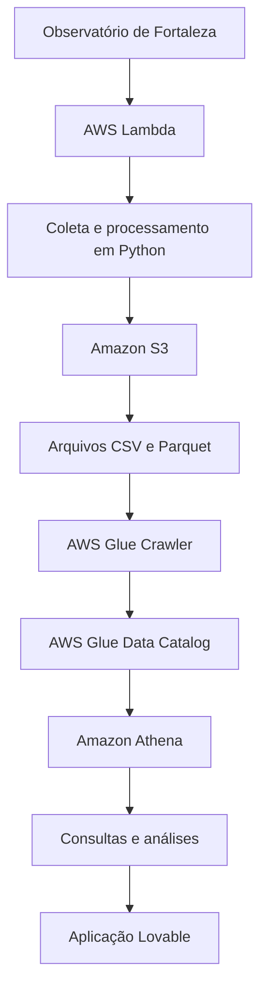
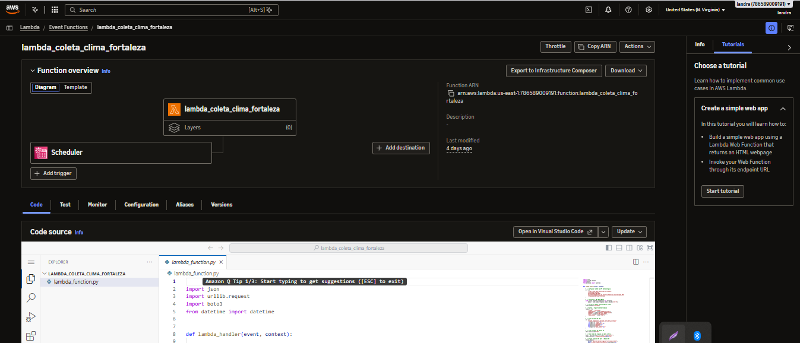
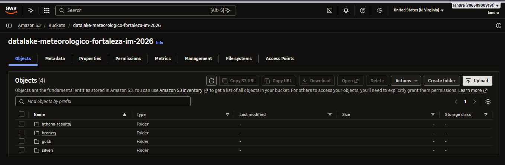
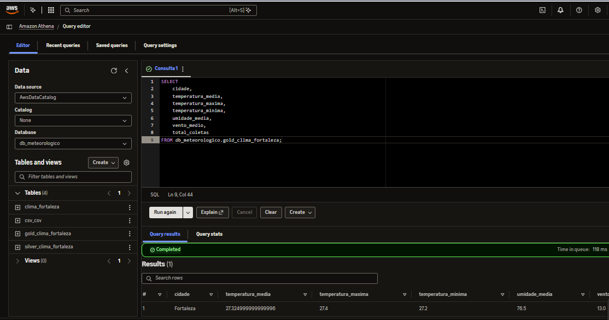

# 🌦️ Data Lake Meteorológico de Fortaleza — AWS

## 📌 Sobre o projeto

Este projeto tem como objetivo desenvolver um fluxo de coleta, armazenamento, organização e consulta de dados meteorológicos da cidade de Fortaleza, Ceará.

A solução utiliza serviços da Amazon Web Services (AWS) para estruturar um Data Lake e disponibilizar os dados para consultas e análises.

A coleta utiliza informações da estação meteorológica 3318, disponibilizadas pelo Observatório de Fortaleza.

O projeto foi desenvolvido como parte dos meus estudos práticos em Engenharia de Dados e Computação em Nuvem.

## 🎯 Objetivos

- Coletar dados meteorológicos de Fortaleza.
- Automatizar a coleta utilizando AWS Lambda.
- Armazenar os dados no Amazon S3.
- Organizar os arquivos em formato Parquet.
- Catalogar os dados utilizando AWS Glue.
- Consultar os dados com Amazon Athena.
- Disponibilizar os resultados em uma aplicação de visualização de dados.

## 🏗️ Arquitetura do projeto

O projeto utiliza serviços da AWS para construir um fluxo de coleta, armazenamento, processamento e consulta de dados meteorológicos.

### Fluxo de processamento

### Etapas da solução

1. Coleta dos dados meteorológicos disponibilizados pelo Observatório de Fortaleza.
2. Execução automatizada da rotina utilizando AWS Lambda.
3. Processamento dos dados com Python.
4. Armazenamento dos arquivos no Amazon S3.
5. Catalogação dos dados utilizando AWS Glue.
6. Consultas e exploração dos dados com Amazon Athena.
7. Disponibilização das informações em uma aplicação de visualização.

## 🛠️ Tecnologias utilizadas

- **AWS Lambda:** execução automatizada da rotina de coleta.
- **Amazon S3:** armazenamento dos dados.
- **AWS Glue:** catalogação dos dados e criação de tabelas.
- **Amazon Athena:** consultas SQL.
- **Python:** coleta e processamento dos dados.
- **Parquet:** formato de armazenamento dos dados.
- **Lovable:** desenvolvimento da aplicação de visualização.

## 🌐 Aplicação de visualização

O projeto conta com uma aplicação desenvolvida no Lovable para apresentar as informações meteorológicas de Fortaleza de maneira visual e organizada.

**Acesse a aplicação:**

[🌦️ Fortaleza Weather Atlas — Visualizar aplicação](https://fortaleza-weather-atlas.lovable.app/)

## 📊 Resultados

O desenvolvimento do projeto permitiu estruturar um fluxo de dados meteorológicos utilizando serviços da AWS.

Entre os resultados alcançados estão:

- Coleta automatizada de dados meteorológicos.
- Armazenamento de arquivos no Amazon S3.
- Organização e catalogação dos dados.
- Consultas SQL utilizando Amazon Athena.
- Aplicação para visualização das informações meteorológicas.

## 🖼️ Evidências do projeto

As capturas de tela da execução dos serviços AWS poderão ser adicionadas nesta seção.

### Execução do AWS Lambda

### Execução do AWS Lambda

### Estrutura de armazenamento no Amazon S3

### Armazenamento no Amazon S3

### Consultas no Amazon Athena

### Consultas no Amazon Athena

### Aplicação meteorológica

[Fortaleza Weather Atlas](https://fortaleza-weather-atlas.lovable.app/)

## 📚 Aprendizados

Durante o desenvolvimento deste projeto, pude praticar conceitos importantes de Engenharia de Dados, como:

- Coleta automatizada de dados.
- Processamento utilizando Python.
- Armazenamento de dados em nuvem.
- Organização de arquivos em Data Lake.
- Utilização de serviços AWS.
- Catalogação e consultas SQL.
- Integração entre dados e aplicações de visualização.

---

**Projeto desenvolvido para fins de aprendizado e construção de portfólio em Engenharia de Dados.**
